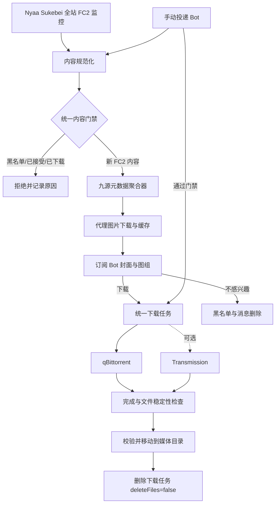

# FC2 / Nyaa BT 自动订阅与整理系统实施规格

- 文档版本：v1.0
- 日期：2026-11-14
- 目标环境：Debian NAS、Docker Compose、私聊 Telegram Bot
- 默认下载器：qBittorrent
- 文档用途：可直接作为编码模型的开发输入，按本文实现首版可运行系统

---

## 1. 项目目标

构建一个运行在 Debian NAS 上的 Docker 化 BT 自动订阅、推送、下载和整理系统。

系统必须完成以下闭环：

1. 监控 Nyaa Sukebei 全站新发布的 FC2 资源，不限定上传者。
2. 通过 Telegram 订阅 Bot 私聊推送封面、标签、标题、日文简介、中文翻译、Nyaa 链接和预览图。
3. 用户点击“下载”后，将磁链投递到 qBittorrent，并将该 FC2 编号永久纳入已接受/已下载去重范围。
4. 用户点击“不感兴趣”后，将该 FC2 编号加入黑名单，并删除本次推送的封面、简介和预览图组。
5. 另一个手动投递 Bot 接收磁链，支持 FC2、普通 JAV、国产、欧美等分类，并共用同一个内容门禁。
6. 下载完成后确认文件稳定，将文件移动到对应媒体目录，然后删除 qBittorrent 任务但不删除已整理文件。
7. 全链路支持按数据源、域名和图片 CDN 配置代理，尤其是日本出口代理。
8. 系统重启、重复回调、重复发布、下载失败和移动失败时不得产生重复任务或误删文件。

仅处理用户有权访问的公开页面和下载内容，不实现绕过登录、付费墙或访问控制的功能。

---

## 2. 首版范围

### 2.1 必须实现

- Nyaa Sukebei 全站 FC2 轮询。
- FC2 编号规范化。
- 两个 Telegram Bot：订阅推送 Bot、手动投递 Bot。
- 九个 FC2 元数据 provider，按固定优先级执行。
- Nyaa 元数据和图片作为最后补充。
- 日本代理、按 provider 和 CDN 的代理路由。
- 封面卡片、预览图组和三个操作按钮。
- FC2 编号级黑名单与已接受记录。
- 手动磁链投递及相同门禁。
- qBittorrent 默认下载器。
- Transmission 可选适配器，首版可只保留接口和基础实现。
- 下载完成监控、文件整理、任务清理。
- SQLite 持久化、结构化日志、Docker Compose 部署。
- 自动化测试与验收脚本。

### 2.2 首版不做

- 公网 Web 管理后台。
- 多用户权限体系。
- Redis、Celery、PostgreSQL 集群。
- 自动绕过验证码、登录或付费限制。
- 根据图片或视频内容进行视觉识别分类。
- 复杂推荐算法。

---

## 3. 技术选型

- Python 3.12。
- aiogram 3.x：两个 Telegram Bot，使用 long polling。
- httpx：异步 HTTP，按路由建立独立客户端。
- selectolax 或 BeautifulSoup：HTML 解析。
- SQLAlchemy 2.x + Alembic：ORM 和数据库迁移。
- SQLite WAL：首版数据库，数据库文件必须位于本地磁盘。
- Pydantic v2 + pydantic-settings：配置校验。
- PyYAML：YAML 配置。
- Pillow：图片验证和尺寸读取。
- Tenacity：有限次数重试。
- structlog：结构化日志。
- FastAPI：仅用于健康检查和可选的内部状态接口。
- pytest、pytest-asyncio、respx：测试。

首版采用模块化单体，不拆微服务。一个容器内运行所有异步任务，避免多容器同时写 SQLite。

---

## 4. 总体架构



核心原则：

- 两个 Bot 共用门禁、数据库、下载编排和整理器。
- 来源适配器不得直接调用 Telegram 或下载器。
- 所有外部副作用必须幂等。
- 文件未成功整理前，绝不删除下载器任务。

---

## 5. 推荐项目结构

```text
app/
  main.py
  config.py
  logging.py
  db/
    models.py
    session.py
    migrations/
  schemas/
    release.py
    metadata.py
    download.py
  sources/
    base.py
    nyaa.py
  providers/
    base.py
    coordinator.py
    fc2.py
    fc2_hub.py
    javdb.py
    mmtv.py
    freejavbt.py
    miss_av.py
    javlibrary.py
    avsox.py
    madou.py
    nyaa_fallback.py
  network/
    proxy.py
    clients.py
    image_fetcher.py
  bots/
    subscription.py
    manual.py
    keyboards.py
    commands.py
  services/
    normalize.py
    gate.py
    metadata.py
    translate.py
    notify.py
  downloaders/
    base.py
    qbittorrent.py
    transmission.py
    coordinator.py
  organizer/
    monitor.py
    paths.py
    mover.py
  api/
    health.py
config/
  example.yaml
tests/
  unit/
  integration/
  fixtures/
Dockerfile
compose.yaml
pyproject.toml
.env.example
```

---

## 6. Nyaa 全站订阅设计

### 6.1 范围

- 目标站点：`https://sukebei.nyaa.si/`。
- 使用全站搜索/RSS，查询 FC2。
- 禁止添加 `u=offkab` 或其他上传者限制。
- RSS 优先，HTML 搜索页作为补漏适配器。

### 6.2 轮询策略

- 默认每 180 秒轮询一次，允许配置 120～300 秒。
- 加入 0～20 秒随机抖动。
- 支持 ETag 和 Last-Modified。
- 每域名默认并发 2，遵守响应中的 Retry-After。
- 保存最近一次 guid、pubDate 和条目 ID。
- 每轮与上一批条目做重叠复核，不能只依赖发布时间严格大于游标。
- 首次启动只处理 `initial_lookback_hours` 范围内的资源，默认 24 小时。
- 如果一轮新条目超过 RSS 窗口，使用搜索分页补漏。

### 6.3 FC2 编号规范化

至少兼容：

- `FC2-PPV-1234567`
- `FC2PPV1234567`
- `FC2 PPV 1234567`
- `FC2-1234567`

统一输出：

```text
content_type = fc2
canonical_key = fc2_ppv:1234567
display_code = FC2-PPV-1234567
```

无法可靠提取编号时，不进入 FC2 自动推送流程，记录过滤原因。

### 6.4 内容与发布分离

同一 FC2 编号可能由多个上传者发布：

- `contents` 中只能有一个 `fc2_ppv:1234567`。
- `releases` 可保存多个来源条目和不同 info hash。
- 只有第一个通过门禁的 release 触发推送。
- 后续 release 只补充候选下载源，不再次通知。

---

## 7. FC2 元数据 provider 链

### 7.1 固定优先级

配置键必须为 `provider.priorities.jav_fc2`，全部 enabled：

| 顺序 | Provider ID | 站点 |
|---:|---|---|
| 1 | Fc2 | adult.contents.fc2.com |
| 2 | fc2_hub | javten.com |
| 3 | Javdb | javdb.com |
| 4 | Mmtv | 7mmtv.sx |
| 5 | freejavbt | freejavbt.com |
| 6 | miss_av | missav123.com |
| 7 | Javlibrary | javlibrary.com |
| 8 | avsox | avsox.click |
| 9 | Madou | madou.club |
| 10 | Nyaa fallback | 当前 Nyaa release 页面 |

不得根据命中率自动改变顺序。当前命中为 0 的 provider 也必须保留。

### 7.2 字段级合并

每个 provider 返回统一 `MetadataResult`：

```python
MetadataResult(
    provider: str,
    content_key: str,
    title_ja: str | None,
    description_ja: str | None,
    official_url: str | None,
    censorship: str | None,
    release_date: datetime | None,
    cover: AssetCandidate | None,
    previews: list[AssetCandidate],
    raw: dict,
)
```

合并规则：

1. 严格按优先级处理。
2. 高优先级字段一旦有效，不被低优先级覆盖。
3. 缺失字段继续向后续 provider 补齐。
4. 封面选择最高优先级的有效图片。
5. 预览图按 provider 优先级和原始顺序合并。
6. 图片使用规范化 URL 和内容 SHA-256 双重去重。
7. 默认最多发送 9 张预览图，可配置。
8. 核心字段齐全且达到 `min_preview_images` 后可提前停止。
9. 单 provider 失败不能终止整个聚合流程。
10. 九源完成后仍缺字段或图片，才使用 Nyaa 页面数据补充。

### 7.3 标签

统一枚举：

- `CENSORED`：有码。
- `UNCENSORED`：无码。
- `THIN`：薄码。
- `UNKNOWN`：未知或来源冲突。

不得仅凭文件名武断判断；保存每个来源的原始标签和最终判定依据。

### 7.4 Provider 实现要求

每个 provider 独立实现，不写一个难以维护的通用解析器：

- 独立搜索/详情 URL 构造。
- 独立 HTML selector。
- 独立超时、代理、重试和并发配置。
- 保存原始元数据 JSON，HTML 可压缩存入缓存目录。
- 使用静态 HTML fixture 做解析测试。
- 线上结构变化时标记 provider 不健康，不影响其他来源。

---

## 8. 代理与图片管道

### 8.1 代理池

至少支持：

- `direct`。
- HTTP/HTTPS 代理。
- SOCKS5H 代理。
- 用户名和密码认证。
- 代理区域标签，例如 `JP`。

默认定义 `direct`、`japan`、`japan_backup`，具体认证信息通过环境变量注入。

### 8.2 路由规则

- 每个 provider 可配置 `metadata_proxy`。
- 每张图片默认继承其 provider 的代理。
- 可按图片 CDN 域名覆盖代理。
- 日本限定来源只能在多个日本出口之间故障转移，不得自动回退到 direct。
- Nyaa 和 Telegram 独立配置代理。
- qBittorrent、Transmission、NAS 地址和数据库永远直连。
- 不依赖全局 HTTP_PROXY；使用应用内显式 HTTP 客户端。

### 8.3 网络稳定性

- 分别配置 connect/read/write/pool timeout。
- 仅对幂等 GET 请求自动重试。
- 默认最多 2 次重试，指数退避并带抖动。
- 按域名限流和熔断。
- 记录 HTTP 状态、目标域名、provider、代理名称和耗时，不记录认证信息。
- 启动时和定期检查代理出口国家/地区及 provider 健康状态。

### 8.4 图片处理

禁止直接把来源站 URL 交给 Telegram：

1. 后端通过指定代理下载图片。
2. 限制响应大小，检查 Content-Type。
3. 使用 Pillow 验证图片可解码并读取尺寸。
4. 写入本地内容哈希缓存。
5. 上传 Telegram。
6. 按 Bot 和文件哈希缓存 Telegram file_id。

需要防御 SVG/脚本伪装、超大图片、图片解压炸弹和恶意重定向。

---

## 9. Telegram 订阅 Bot

### 9.1 消息结构

第一条消息使用 `sendPhoto`：

- 封面图。
- 有码/无码/薄码/未知标签。
- 标题。
- FC2 编号。
- 日文简介。
- 中文翻译。
- Nyaa 直达链接。
- 三个按钮。

随后使用 `sendMediaGroup` 发送预览图，每组 2～10 张。

如果简介超过 Telegram caption 限制：

- 封面 caption 保留编号、标签、标题和链接。
- 完整日文及中文简介发送为后续关联文本消息。
- 不得静默截断正文。

数据库必须保存封面、简介和全部图组消息 ID，以支持整组删除。

### 9.2 按钮

按钮顺序：

1. 下载：callback_data 使用短 ID，例如 `dl:<job_or_content_uuid>`。
2. 不感兴趣：例如 `blk:<content_uuid>`。
3. FC2 官网：URL 按钮。

callback_data 不得超过 Telegram 限制，不得塞入磁链或长 URL。

### 9.3 下载回调

事务顺序：

1. 校验 Telegram 用户和私聊白名单。
2. 立即 answerCallbackQuery，避免客户端超时。
3. 在数据库事务中复核门禁。
4. 首次点击时写入 accepted_entries，来源为 subscription_button。
5. 创建或复用 download_job。
6. 调用 qBittorrent 添加磁链。
7. 成功接受后把按钮改为“已下载”。
8. 添加失败则按钮显示“重试”，任务标记 FAILED，但 accepted_entries 保留，防止再次推送。

重复点击必须返回“已处理”，不得重复添加任务。

### 9.4 不感兴趣回调

1. 校验白名单。
2. 事务性写入 blacklist_entries，唯一键为 canonical_key。
3. 记录 decision_events。
4. 删除封面、简介和全部预览图组消息。
5. Telegram 删除失败只记录错误并安排重试，不能回滚黑名单。

---

## 10. 手动投递 Bot

支持用户直接发送磁链，后续可扩展 torrent 文件。

处理顺序：

1. 校验用户白名单。
2. 解析 magnet、info hash、显示名称和可能的 FC2/JAV 编号。
3. FC2 编号按统一规则规范化。
4. 调用与订阅 Bot 完全相同的内容门禁。
5. 黑名单或已接受编号直接拒绝，并回复原因。
6. 无稳定编号的普通资源使用 info hash 去重。
7. 根据路由规则选择分类和最终目录。
8. 分类不明确时展示分类按钮；未确认前进入 `_review`。
9. 写入 accepted_entries 和 download_job。
10. 默认添加至 qBittorrent。
11. 下载完成后复用统一整理器。

首版分类：`fc2`、`jav`、`cn`、`western`、`review`。分类名称和目录必须可配置。

管理命令建议：

- `/status`：运行状态、活动任务和最近错误。
- `/retry <job_id>`：重试原任务，不创建新内容。
- `/block <FC2编号>`：添加黑名单。
- `/unblock <FC2编号>`：解除黑名单，但不清除已接受记录。
- `/pause`、`/resume`：暂停/恢复订阅轮询。
- `/providers`：查看 provider 健康状态。

---

## 11. 统一内容门禁

### 11.1 准入顺序

```text
1. canonical_key 是否在 blacklist_entries
2. canonical_key 是否在 accepted_entries
3. info_hash 是否存在于活动或已完成 download_jobs
4. source + source_item_id 是否已经处理
5. 全部通过才允许推送或创建任务
```

黑名单优先级最高。

### 11.2 并发与幂等

- `contents.canonical_key` 唯一。
- `accepted_entries.canonical_key` 唯一。
- `blacklist_entries.canonical_key` 唯一。
- `releases(source, source_item_id)` 唯一。
- 非空 info hash 建唯一索引。
- 门禁检查和 accepted 写入必须在同一数据库事务。
- 下载任务使用幂等键 `download:<release_id>`。
- 回调处理使用幂等键 `callback:<callback_id>` 或内容状态条件更新。

### 11.3 失败语义

点击下载即代表用户已接受该内容，因此即使 qBittorrent 添加失败：

- accepted_entries 不删除。
- 不重新推送该编号。
- 只能重试原 download_job。
- 管理员如要彻底重新接收，需要显式清除 accepted 记录，首版可不提供该命令。

---

## 12. 数据库设计

### 12.1 contents

- id：UUID/主键。
- content_type：fc2/jav/generic。
- canonical_key：唯一。
- display_code。
- title_ja、description_ja、description_zh。
- censorship。
- official_url。
- metadata_status。
- created_at、updated_at。

### 12.2 releases

- id。
- content_id。
- source。
- source_item_id。
- source_url。
- magnet。
- info_hash。
- raw_title。
- published_at。
- raw_payload_json。
- created_at。

唯一约束：`source + source_item_id`；info hash 非空时唯一。

### 12.3 provider_results

- id、content_id、provider。
- success、http_status、error_code。
- latency_ms。
- result_json。
- asset_count。
- fetched_at。

### 12.4 assets

- id、content_id、provider。
- role：cover/preview。
- original_url、final_url。
- cdn_host、proxy_profile。
- sha256、local_path。
- telegram_file_id、telegram_bot。
- width、height、size_bytes。
- position、created_at。

### 12.5 accepted_entries

- canonical_key：唯一。
- content_id。
- origin：subscription_button/manual/admin。
- created_at。

### 12.6 blacklist_entries

- canonical_key：唯一。
- content_id。
- reason。
- created_by。
- created_at。

### 12.7 download_jobs

- id、release_id、content_id。
- downloader：qbittorrent/transmission。
- downloader_task_id、info_hash。
- status。
- category。
- remote_save_path、remote_content_path。
- local_content_path、final_path。
- error_code、error_message、retry_count。
- created_at、submitted_at、completed_at、organized_at、removed_at。

### 12.8 notifications

- id、content_id、bot_name、chat_id。
- poster_message_id。
- description_message_ids_json。
- media_message_ids_json。
- status、created_at、deleted_at。

### 12.9 source_cursors 与 decision_events

- source_cursors 保存每个来源的游标、最后成功时间和连续失败次数。
- decision_events 保存接受、拉黑、重试、状态变化等审计事件。

---

## 13. 下载状态机

```text
DISCOVERED
  -> NOTIFIED
  -> ACCEPTED
  -> SUBMITTED
  -> DOWNLOADING
  -> DOWNLOADED
  -> ORGANIZING
  -> ORGANIZED
  -> TASK_REMOVED
```

旁路状态：

- BLOCKED：黑名单或门禁拒绝。
- FAILED：可重试失败，必须保留错误阶段。
- CANCELLED：管理员取消，首版可选。

要求：

- 每次状态变化记录时间和错误。
- 状态更新使用条件更新，防止多个异步任务同时推进。
- 容器启动时扫描 SUBMITTED、DOWNLOADING、DOWNLOADED、ORGANIZING 任务并与 qBittorrent 对账。
- 不追求分布式 exactly-once，使用 at-least-once + 幂等副作用。

---

## 14. qBittorrent 适配器

qBittorrent 是所有路由的默认下载器。

### 14.1 添加任务

- 使用 Web API 添加 magnet。
- 每个任务设置独立 savepath。
- 建议路径：`/downloads/<category>/<job_id>/`。
- 设置 category 或 tag 以关联内部 job_id。
- 若显式指定 savepath，应避免自动管理模式覆盖该路径。
- 添加后通过 info hash 查询并保存真实任务信息。
- qBittorrent 成功接受后才把订阅按钮改为“已下载”。

### 14.2 完成判断

不能只依赖目录文件出现：

1. 定时调用 torrents/info。
2. 检查 `progress == 1.0`。
3. 检查任务处于完成、做种或等价完成状态。
4. 获取实际 content_path/save_path。
5. 排除 `.!qB` 等临时文件。
6. 连续两次检查文件数量和总大小不变，间隔默认 10 秒。

### 14.3 删除任务

只有整理器报告全部文件成功后才允许删除：

- 调用 torrents/delete。
- `deleteFiles=false`。
- 删除后再次查询确认任务消失。
- 若删除失败，文件已整理则保持 ORGANIZED 并安排删除重试，不回滚媒体文件。

---

## 15. Transmission 可选适配器

实现与 qBittorrent 相同的 Downloader 接口：

- add。
- get_by_hash。
- list_active。
- is_complete。
- get_content_path。
- remove(delete_local_data=false)。

首版默认禁用，配置启用后可被特定路由显式选择。

---

## 16. 文件整理器

### 16.1 路径映射

下载器路径与整理器路径必须显式配置，例如：

```text
下载器 /downloads -> 应用容器 /downloads
```

禁止通过字符串随意替换未配置路径。

### 16.2 目标目录

默认模板：

```text
/library/fc2/<display_code>/
/library/jav/<normalized_code_or_infohash>/
/library/cn/<normalized_name_or_infohash>/
/library/western/<normalized_name_or_infohash>/
/library/_review/<normalized_name_or_infohash>/
```

目录名清理非法字符、控制长度、防止路径穿越。最终路径必须位于配置的媒体根目录内。

### 16.3 移动算法

同文件系统：

1. 创建目标目录。
2. 使用原子重命名。
3. 校验目标文件存在和大小。

跨文件系统：

1. 在目标目录创建 `.partial` 文件。
2. 流式复制并 flush/fsync。
3. 校验文件大小，可选 SHA-256。
4. 原子重命名为最终文件。
5. 所有文件成功后再删除源文件和空目录。

任何一步失败：

- 保留 qBittorrent 任务和源文件。
- 记录失败文件、阶段和错误。
- 任务进入 FAILED 或保持 ORGANIZING 等待重试。
- 发送 Telegram 管理通知。

---

## 17. 标准扩展接口

### 17.1 SourceAdapter

```python
class SourceAdapter(Protocol):
    async def discover(self, cursor: dict | None) -> list[ReleaseCandidate]: ...
```

`ReleaseCandidate` 至少包含：

- source、source_item_id、source_url。
- title、published_at。
- magnet、info_hash。
- description、assets。
- content_hint。
- censorship_hint。
- raw_payload。

### 17.2 MetadataProvider

```python
class MetadataProvider(Protocol):
    id: str

    async def fetch(self, content: Content, ctx: ProviderContext) -> MetadataResult: ...
```

### 17.3 Downloader

```python
class Downloader(Protocol):
    async def add(self, request: DownloadRequest) -> DownloadHandle: ...
    async def get(self, handle: DownloadHandle) -> DownloadStatus: ...
    async def remove(self, handle: DownloadHandle, delete_files: bool = False) -> None: ...
```

新增网站时只添加 SourceAdapter 和配置，不得修改 Bot、门禁或整理器。

---

## 18. 配置示例

```yaml
app:
  timezone: Asia/Shanghai
  database_url: sqlite:////app/data/app.db
  log_level: INFO

telegram:
  subscription_bot_token: ${SUBSCRIPTION_BOT_TOKEN}
  manual_bot_token: ${MANUAL_BOT_TOKEN}
  allowed_user_ids: ${TELEGRAM_ALLOWED_USER_IDS}
  proxy: direct

nyaa:
  base_url: https://sukebei.nyaa.si
  query: FC2
  scope: site
  poll_interval_seconds: 180
  initial_lookback_hours: 24
  proxy: direct

provider:
  priorities:
    jav_fc2: [Fc2, fc2_hub, Javdb, Mmtv, freejavbt, miss_av, Javlibrary, avsox, Madou]
  sources:
    Fc2: {host: adult.contents.fc2.com, enabled: true, proxy: japan}
    fc2_hub: {host: javten.com, enabled: true, proxy: japan}
    Javdb: {host: javdb.com, enabled: true, proxy: japan}
    Mmtv: {host: 7mmtv.sx, enabled: true, proxy: japan}
    freejavbt: {host: freejavbt.com, enabled: true, proxy: japan}
    miss_av: {host: missav123.com, enabled: true, proxy: japan}
    Javlibrary: {host: javlibrary.com, enabled: true, proxy: japan}
    avsox: {host: avsox.click, enabled: true, proxy: japan}
    Madou: {host: madou.club, enabled: true, proxy: japan}

proxy_profiles:
  direct: {type: direct}
  japan: {type: socks5h, url: ${JP_PROXY_URL}, region: JP}
  japan_backup: {type: http, url: ${JP_BACKUP_PROXY_URL}, region: JP}

image_fetch:
  default_proxy: inherit_provider
  max_bytes: 20971520
  max_previews: 9
  min_preview_images: 3
  cdn_routes: {}

translation:
  enabled: true
  provider: openai_compatible
  base_url: ${TRANSLATION_BASE_URL}
  api_key: ${TRANSLATION_API_KEY}
  model: ${TRANSLATION_MODEL}
  target_language: zh-CN

download:
  default_downloader: qbittorrent
  routes:
    fc2: qbittorrent
    jav: qbittorrent
    cn: qbittorrent
    western: qbittorrent
    review: qbittorrent

downloaders:
  qbittorrent:
    enabled: true
    url: ${QBITTORRENT_URL}
    username: ${QBITTORRENT_USERNAME}
    password: ${QBITTORRENT_PASSWORD}
  transmission:
    enabled: false
    url: ${TRANSMISSION_URL}
    username: ${TRANSMISSION_USERNAME}
    password: ${TRANSMISSION_PASSWORD}

storage:
  path_mappings:
    - remote: /downloads
      local: /downloads
  final_roots:
    fc2: /library/fc2
    jav: /library/jav
    cn: /library/cn
    western: /library/western
    review: /library/_review
```

实现环境变量展开、配置校验和启动失败快速报错。密钥只放 `.env` 或 Docker secrets。

---

## 19. Docker Compose 基线

```yaml
services:
  app:
    build: .
    container_name: bt-automation
    restart: unless-stopped
    env_file: .env
    environment:
      TZ: Asia/Shanghai
    volumes:
      - ./config:/app/config:ro
      - ./data:/app/data
      - /mnt/storage/downloads:/downloads
      - /mnt/storage/library:/library
    ports: []
```

要求：

- qBittorrent 可以是 NAS 上已有服务，通过 QBITTORRENT_URL 访问。
- 不需要公网端口，因为 Telegram 使用 long polling。
- 应用与 qBittorrent 的下载目录权限必须一致。
- 容器使用非 root 用户运行。
- SQLite 数据目录使用本地磁盘，不放 NFS/SMB。
- 不挂载 Docker socket。
- 提供健康检查、优雅停止和启动对账。
- 每日备份 `/app/data` 与配置。

---

## 20. 安全要求

- Telegram 只允许指定用户 ID 和私聊 chat ID。
- 所有命令、回调都重复校验身份，不能只依赖按钮隐藏。
- 配置和日志中的 token、密码、代理认证必须脱敏。
- 图片和页面 URL 需要域名 allowlist、重定向检查和响应大小限制。
- 防止 SSRF 访问 NAS 内网、localhost 和云元数据地址。
- 最终文件路径必须规范化并限制在媒体根目录内。
- 不执行下载得到的任何文件。
- 对网页和图片请求设置严格超时。
- 外部请求默认不信任，解析失败不能导致整个进程退出。

---

## 21. 日志与观测

结构化字段：

- content_id、canonical_key、release_id、job_id。
- source、provider、downloader。
- proxy_profile、目标域名。
- status、latency_ms、retry_count、error_code。

至少统计：

- 每轮 Nyaa 新条目、过滤、去重和推送数量。
- 每个 provider 的命中率、耗时和图片数量。
- 每个代理的出口地区和失败率。
- qBittorrent 活动任务、完成任务和整理失败数量。
- Telegram 推送、按钮回调和消息删除失败数量。

已知历史命中基线可用于对照：Fc2 53.7%、fc2_hub 25.6%、Mmtv 14.0%、miss_av 5.3%、freejavbt 1.4%，其余为 0。该数据只用于观测，不用于自动调整顺序。

---

## 22. 测试要求

### 22.1 单元测试

- FC2 编号各种格式规范化。
- 内容与 release 分层去重。
- 黑名单、已接受、info hash 的准入顺序。
- 九源字段级合并与图片去重。
- provider 代理和 CDN 路由。
- qBittorrent 完成状态判断。
- 路径映射、目录清理和跨盘移动。
- Telegram caption 超长拆分。

### 22.2 Provider 测试

- 每个 provider 使用静态 HTML fixture。
- 测试正常页面、缺字段、无图片、结构变化和错误页面。
- 默认测试不依赖真实网站。
- 单独提供手动 live smoke test，不在 CI 高频请求网站。

### 22.3 集成测试

使用 fake qBittorrent 和 fake Telegram：

- 点击下载只创建一个任务。
- 按钮双击和进程重启不重复添加。
- 不感兴趣先写黑名单再删除消息。
- 黑名单编号通过手动 Bot 投递仍被拒绝。
- 下载完成后才整理。
- 移动失败绝不删除 qBittorrent 任务。
- 删除任务始终 deleteFiles=false。

---

## 23. 分阶段开发顺序

### M1：可运行骨架

- 配置、日志、数据库迁移。
- 统一模型、门禁和状态机。
- qBittorrent 适配器。
- 手动 Bot 磁链投递。
- 文件整理和任务清理。

### M2：Nyaa 订阅

- 全站 FC2 RSS/搜索适配器。
- 游标、重叠复核和首次启动窗口。
- 内容与 release 去重。

### M3：元数据和代理

- 九个 provider。
- 字段级合并。
- 代理池和 CDN 路由。
- 图片缓存与 Telegram 上传。
- 中文翻译。

### M4：卡片与完整闭环

- 封面、简介和预览图组。
- 下载、不感兴趣、官网按钮。
- 消息整组删除。
- 失败重试和启动对账。

### M5：加固

- Transmission 可选适配器。
- 管理命令、健康检查和指标。
- 完整集成测试、备份和部署文档。

---

## 24. 最终验收清单

只有以下全部通过才算首版完成：

- [ ] Nyaa 监控为全站 FC2，不包含 offkab 用户限制。
- [ ] 九源顺序与本文完全一致，全部 enabled。
- [ ] FC2 官方为第 1 来源，Nyaa 为最后补充。
- [ ] 日本 provider 和图片 CDN 可按配置走日本代理。
- [ ] 图片由后端代理下载后上传 Telegram。
- [ ] 卡片包含封面、标签、标题、日文简介、中文简介和 Nyaa 链接。
- [ ] 预览图组紧随封面/简介消息。
- [ ] 下载成功后按钮显示“已下载”。
- [ ] 不感兴趣后黑名单生效，并删除整组消息。
- [ ] 同一 FC2 编号不同上传者、不同磁链不会重复推送。
- [ ] 黑名单和已接受编号无法通过手动 Bot 再次进入下载。
- [ ] FC2 与手动投递默认均使用 qBittorrent。
- [ ] qBittorrent 任务完成后才进入整理。
- [ ] 文件整理成功前绝不删除任务。
- [ ] 删除任务使用 deleteFiles=false。
- [ ] 跨盘移动失败时源文件和任务均保留。
- [ ] 容器重启后任务可恢复对账，不重复投递。
- [ ] 两个 Bot 均只允许白名单用户私聊操作。
- [ ] 配置、数据库和日志可从 Docker 卷持久化并备份。

---

## 25. 编码实施约束

编码模型在实现时应遵守：

1. 先实现门禁、状态机和文件安全，再实现网页刮削。
2. 不为赶进度删除去重、事务、失败保护或测试。
3. 不把密钥写进源码或示例的真实值。
4. 不将 provider 顺序改写成按命中率排序。
5. 不使用全局代理影响 qBittorrent 和 NAS 内网请求。
6. 不在下载完成前移动文件。
7. 不在整理成功前删除种子任务。
8. 对不确定的网站 selector 使用独立适配器和 fixture，不伪造抓取成功。
9. 首版保持模块化单体，避免引入不必要的基础设施。
10. 最终交付必须包含可运行的 compose.yaml、.env.example、数据库迁移和测试。
